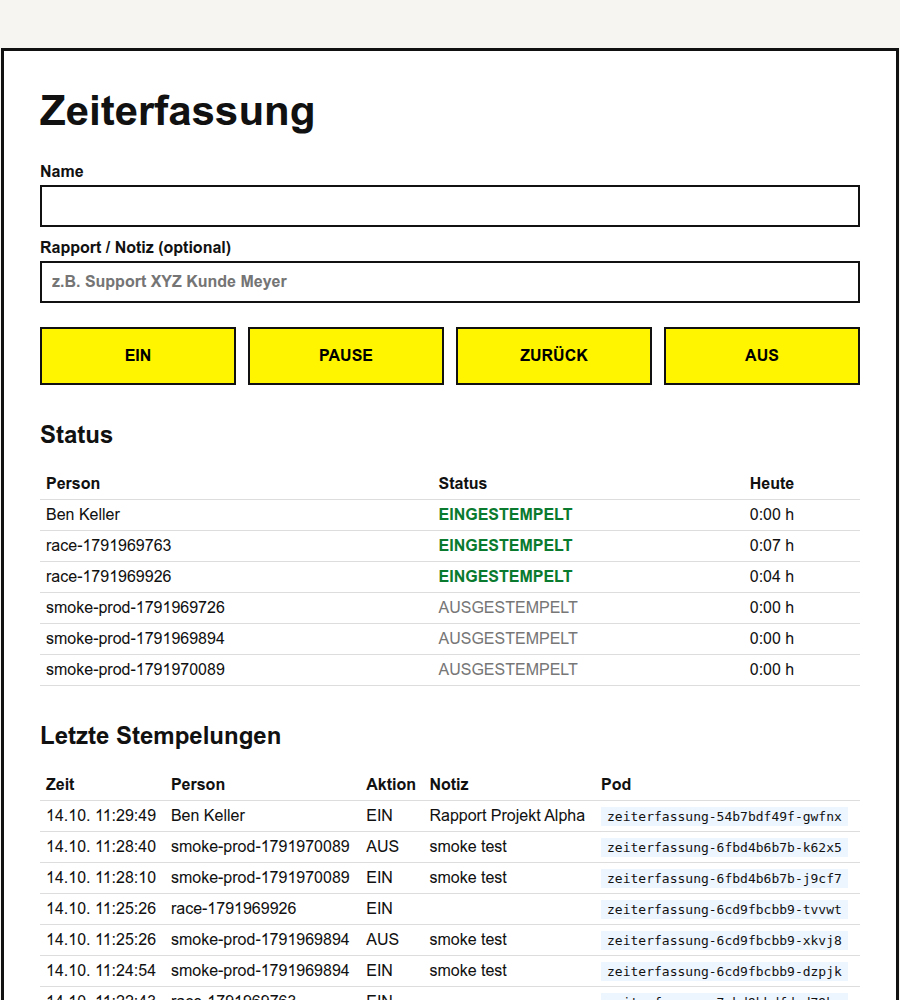

# Zeiterfassung

A small time-tracking service for the SAII HS2026 Kubernetes assignment. People type their name, stamp `EIN`, `PAUSE`, `ZURÜCK` or `AUS`, optionally with a note, and see a status board with everyone's current status and the time worked today. It runs on a local k3d cluster as a dev and a prod environment, built from one Kustomize base.



## requirements

| Tool | Tested with | Note |
| --- | --- | --- |
| Docker | 29.9 (rootless) | rootful works too, see [rootless docker](#rootless-docker) |
| k3d | 5.8.3 | replaces minikube from the course |
| kubectl | 1.35 | |
| make, curl | any | |
| Python | 3.13 | only for the unit tests |
| Typst | 0.15 | only to build `docs/abgabe.pdf` |

The host ports `8080`, `8081` and `5050` have to be free.

## quick start

```bash
make cluster   # registry + single node k3d cluster
make dev       # build, import image, deploy dev
make prod      # build, push image to the registry, deploy prod
make smoke     # stamp, delete every pod, check the data is still there
```

Then open:

- dev: <http://localhost:8080>
- prod: <http://zeiterfassung.localhost:8081>

`*.localhost` resolves to `127.0.0.1` in browsers and curl. If your resolver doesn't do that, add `127.0.0.1 zeiterfassung.localhost` to `/etc/hosts`.

`make help` lists all targets. Every target is a thin wrapper, the steps below are the same thing without `make`.

## step by step

#### 1. registry and cluster

```bash
k3d registry create registry.localhost --port 5050
k3d cluster create saii --agents 0 \
  --registry-use k3d-registry.localhost:5050 \
  --port "8080:30080@loadbalancer" \
  --port "8081:80@loadbalancer" \
  --wait
kubectl config use-context k3d-saii
kubectl get nodes
kubectl get storageclass   # local-path (default)
```

`--agents 0` is on purpose. The data volume is `ReadWriteOnce` on `local-path`, which is node local, so all three prod replicas have to run on the same node to share it (see [ADR-0001](docs/adr/0001-k3d-single-node-cluster.md)). Port `8080` goes to the dev NodePort `30080`, port `8081` goes to Traefik, which serves the prod ingress.

#### 2. dev

Dev uses a local image that is imported straight into the cluster, no registry involved.

```bash
docker build -t zeiterfassung:1.3 --build-arg APP_VERSION=1.3 app
k3d image import zeiterfassung:1.3 -c saii --mode direct
kubectl kustomize k8s/overlays/dev        # look at it before applying
kubectl apply -k k8s/overlays/dev
kubectl -n zeiterfassung-dev rollout status deployment/zeiterfassung
kubectl -n zeiterfassung-dev get pods,svc,pvc
```

#### 3. prod

Prod pulls from the k3d registry, like a real cluster would pull from a registry.

```bash
docker tag zeiterfassung:1.3 localhost:5050/zeiterfassung:1.3
docker push localhost:5050/zeiterfassung:1.3
kubectl apply -k k8s/overlays/prod
kubectl -n zeiterfassung-prod rollout status deployment/zeiterfassung
kubectl -n zeiterfassung-prod get pods,svc,pvc,ingress -o wide
```

The host pushes to `localhost:5050`, inside the cluster the same registry is `k3d-registry.localhost:5050`, which is the name the prod overlay uses.

#### 4. try it

```bash
curl -s localhost:8080/health
curl -s -X POST localhost:8080/stamp -H 'Content-Type: application/json' \
  -d '{"name":"Anna Meyer","action":"EIN","note":"Support XYZ Kunde Meyer"}'
curl -s localhost:8080/board
curl -s localhost:8080/events
```

Persistence, the same thing `make smoke` checks:

```bash
kubectl -n zeiterfassung-dev delete pod -l app=zeiterfassung
kubectl -n zeiterfassung-dev rollout status deployment/zeiterfassung
curl -s localhost:8080/events   # the stamp is still there
```

## dev vs prod

| | dev | prod |
| --- | --- | --- |
| namespace | `zeiterfassung-dev` | `zeiterfassung-prod` |
| replicas | 1 | 3 |
| service | `NodePort` 30080 | `ClusterIP` + Traefik `Ingress` |
| image | `zeiterfassung:1.3`, imported | `k3d-registry.localhost:5050/zeiterfassung:1.3`, pulled |
| resources | 50m / 64Mi requested, 250m / 128Mi limit | 100m / 128Mi requested, 500m / 256Mi limit |
| url | `localhost:8080` | `zeiterfassung.localhost:8081` |

## api

| Method | Path | What it does |
| --- | --- | --- |
| `GET` | `/` | UI |
| `POST` | `/stamp` | form post => `303` to `/`, JSON post => `201` with the stamp. `400` on invalid input, `409` on a transition that isn't allowed |
| `GET` | `/board` | status and worked seconds today per person |
| `GET` | `/events` | last 20 stamps |
| `GET` | `/health` | writes a probe file to `/data` and queries the database, `503` if either fails |

Allowed transitions per person: out -> `EIN` -> working -> `PAUSE` -> on break -> `ZURUECK` -> working -> `AUS` -> out.

## tests and checks

```bash
make test    # unit tests (state machine, validation, escaping, concurrency, health)
make smoke   # against the running cluster, both environments
make scan    # trivy image scan, HIGH and CRITICAL only
```

## minikube equivalents

The course uses minikube everywhere, this is the mapping.

| minikube | here |
| --- | --- |
| `minikube start` | `k3d cluster create saii ...` |
| `minikube image load zeiterfassung:1.3` | `k3d image import zeiterfassung:1.3 -c saii --mode direct` |
| `minikube kubectl -- get pods` | `kubectl get pods` |
| `minikube service zeiterfassung` | fixed port mapping, `localhost:8080` |
| `minikube addons enable ingress` | Traefik ships with k3s |
| `minikube addons enable registry` | `k3d registry create` |
| `minikube delete` | `k3d cluster delete saii` |

## rootless docker

On rootless Docker two things break with the k3d defaults, the Makefile detects rootless and handles both:

- the kubelet can't open `/dev/kmsg` inside the user namespace and k3s never becomes ready. Fix: `--k3s-arg "--kubelet-arg=feature-gates=KubeletInUserNamespace=true@server:*"` on `k3d cluster create`
- `k3d image import` starts a tools container that mounts `/var/run/docker.sock`, which doesn't exist on rootless. Fix: `--mode direct`

## layout

```text
app/                 Flask app, Dockerfile, tests
k8s/base/            deployment, service, pvc
k8s/overlays/dev/    1 replica, NodePort, imported image
k8s/overlays/prod/   3 replicas, ClusterIP, ingress, registry image
smoke.sh             end to end check against the cluster
CONTEXT.md           domain glossary
docs/adr/            architecture decisions
docs/decisions.md    every decision from planning
docs/ai-decision-log.md
docs/abgabe.typ      submission document, `make docs` builds the PDF
```

## cleanup

> **Warning:** `make clean` deletes the cluster and the registry, including the volumes. All stamps are gone afterwards.

```bash
make clean
```
